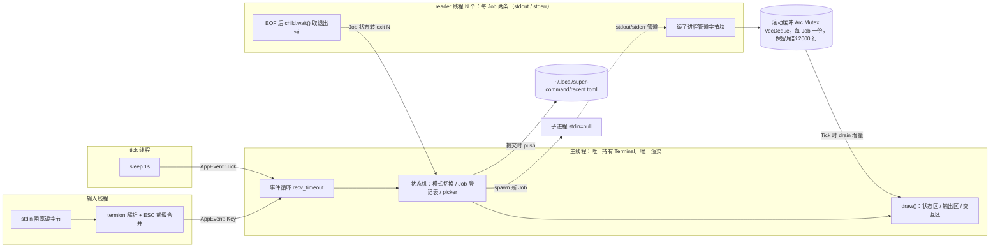

# Change: command-manager-tui

**Status**: draft
**Date**: 2026-09-24（2026-09-27 修订）
**Author**: fisher

## Summary

新建 `super-command`：一个**命令管理器** TUI（非通用 shell），持久化记录常用命令（程序路径、参数、环境变量、工作目录）。用户通过输入框触发键 `#`（命令库）/ `/`（内置命令）弹出选择列表，`Enter` 选中、`Alt+Enter` 提交执行。页面采用状态/输出/交互三区布局（详见 `tui-page-layout.md`），键位详见 `keybindings.md`。

## Motivation

日常开发中反复执行长命令行（cargo 组合、带环境变量的调试启动、跨目录脚本）。历史记录散落在 shell history 中，无法结构化保存参数与环境变量。需要一个可检索、可一键执行的命令库。

**边界**：本工具只执行命令库中预先注册的条目，不接受自由文本命令行，不支持交互式命令（vim、htop、python REPL 等需要用户持续输入的 TTY 程序）。

## Design

### 技术选型

| 项 | 选择 | 理由 |
|---|---|---|
| TUI 框架 | `ratatui` + `termion` | ratatui 负责渲染，termion 为 Unix-only 终端后端；仅 Linux 平台，依赖树无跨平台兼容层与 Windows 依赖 |
| 存储格式 | TOML（`serde` + `toml`） | 人类可手改，数组与内联 table 天然表达 args/env |
| `cmd` 拆分 | `shlex` | 按 POSIX shell 引号/转义规则把整行拆成 argv，不经 shell 执行 |
| 路径解析 | 硬编码 `~/.config` 与 `~/.local`，读 `$HOME` 拼接 | 仅 Linux，两个数据目录不共享同一前缀（见「存储路径」），不引入 `directories` crate |
| 错误类型 | `thiserror` 定义库侧具体错误 | 二进制 crate 内部 main 可用 `anyhow`（本设计统一用 `thiserror`） |

### 存储路径

两个文件均**硬编码路径**，不使用 XDG 库推导：

| 用途 | 路径 | 读写 |
|---|---|---|
| 命令库 | `~/.config/super-command/commands.toml` | 程序内**只读**；增删改由用户手工编辑文件 |
| 最近执行 | `~/.local/super-command/recent.toml` | 程序读写；每次提交执行后立即写回 |

目录不存在则创建（含父目录）。`~` 展开取 `$HOME`；`$HOME` 未设置时启动报错退出。

命令库只在**启动时加载一次**，运行期间不监听文件变化。用户手工编辑 `commands.toml` 后，需退出并重新进入程序才能生效。

### 数据模型

```toml
# ~/.config/super-command/commands.toml
[[command]]
name = "clippy-all"            # 列表显示名，必填
comment = "全量 clippy 检查"    # 命令说明，可省略；列表中另起一行展示
program = "cargo"              # 程序路径；支持绝对路径或 PATH 内名称
args = ["clippy", "--all-targets"]   # 参数数组，可省略
env = { RUST_LOG = "debug" }   # 环境变量 map，可省略
cwd = "~/code/rust/foo"        # 工作目录，可省略；支持 ~ 展开
hosts = "~/hosts/test"         # 替换 /etc/hosts 的文件，可省略；绝对路径或 ~/ 开头

[[command]]
name = "cowork-docker"
cmd = """
docker run -d --network host \
  -v /home/fisher/docker/cowork/workspaces:/home/workspaces \
  --name cowork cowork
"""                            # 整行命令（程序 + 参数），与 program/args 二选一
```

#### `cmd` 与 `program` / `args`

每个条目**二选一**：写 `cmd`（整行），或写 `program`（+ 可选 `args`）。

* 加载时 `cmd` 按 shell 引号/转义规则拆成 argv：首项为 `program`，其余为 `args`。拆分后与直接写 `program`/`args` 的条目完全等价，执行、预览、recent 副本都只见 `program`/`args`；
* **只借用 shell 的拆词规则，不经 shell 执行**：`$VAR`、参数内 `~`、管道、`&&`、重定向、通配符均不生效；需要这些能力时写 `program = "sh"`、`args = ["-c", "..."]`；
* 行内环境变量前缀（`FOO=bar cmd ...`）不支持，环境变量写 `env`；
* 长命令可用 TOML `"""` 多行字符串，行尾 `\` 由 TOML 负责拼接；
* 以下情况视为配置错误，启动报错退出（见「错误处理」）：`cmd` 与 `program`/`args` 同时出现；二者都没有；`cmd` 为空或引号未闭合。

#### `hosts`：独立 hosts 环境

设置后该命令在独立 mount namespace 中执行，`/etc/hosts` 被替换为指定文件，不影响系统 hosts。`cmd` 与 `program`/`args` 两种写法都可搭配。

* 存**原始写法**（未展开）；执行时 `~/` 按 `cwd` 同规则展开；
* 加载时校验：为空或全空白 → 报错（不静默当作未设置，避免误用系统 hosts）；既不是绝对路径也不以 `~/` 开头 → 报错；
* 加载时**不检查文件是否存在**（可能是临时生成的文件），执行时由 bwrap 报错；
* 执行时由 `build_spec` 把原命令包进 bwrap（见「子进程 I/O 约定」）；`CommandEntry`、列表预览、recent 副本只保存原始 `program`/`args` + `hosts`，不出现 bwrap 参数；
* 以当前用户身份运行，无需 sudo；`env` / `cwd` 照旧生效；命令处于独立 PID namespace，`ps` 只能看到自身进程树。

不用 `sudo unshare` 的原因：stdin 为 null 无法输入 sudo 密码；命令以 root 运行且 sudo 重置环境变量；退出清理对 `sudo` 发 `SIGKILL` 无法转发，留下用户杀不掉的 root 孤儿进程。免 sudo 的 `unshare -r` 在启用 `kernel.apparmor_restrict_unprivileged_userns` 的 Ubuntu 上被拦截，bwrap 有 AppArmor profile 放行。

```toml
# ~/.local/super-command/recent.toml
# 数组顺序即 MRU 顺序：下标 0 = 最近执行
[[recent]]
name = "clippy-all"
comment = "全量 clippy 检查"
program = "cargo"
args = ["clippy", "--all-targets"]
cwd = "~/code/rust/foo"
[recent.env]
RUST_LOG = "debug"
```

Rust 结构：

```rust
#[derive(Serialize, Deserialize, Clone, Debug, PartialEq, Eq)]
pub struct CommandEntry {
    pub name: String,
    pub program: String,
    #[serde(default)]
    pub args: Vec<String>,
    #[serde(default)]
    pub env: BTreeMap<String, String>,
    #[serde(default)]
    pub cwd: Option<String>,
    #[serde(default, skip_serializing_if = "Option::is_none")]
    pub comment: Option<String>,
    #[serde(default, skip_serializing_if = "Option::is_none")]
    pub hosts: Option<String>,
}
```

`CommandEntry` 是加载后的统一形态，不含 `cmd`；库文件条目先按「`cmd` 与 `program` / `args`」规则解析校验再转换成它。

`name` 为空或全空白的库条目在加载时**跳过**（无法显示也无法匹配），不报错、不改写文件；跳过先于 `cmd`/`program` 校验。

最近执行条目**复用同一 `CommandEntry` 类型**，不另建结构体：它存的是执行时该条目的完整副本（name + program + args + env + cwd + hosts + comment），字段形状与库条目一致，只是语义上是历史快照而非库引用。

`recent.toml` 顶层结构：

```rust
#[derive(Serialize, Deserialize, Default)]
struct RecentFile {
    #[serde(default)]
    recent: Vec<CommandEntry>,
}
```

### recent 记录规则

| 规则 | 定义 |
|---|---|
| 写入时机 | **提交即写**（`Alt+Enter` 或列表内确认执行的那一刻），不等 spawn 成功。故 `spawn failed` 的条目也会进 recent |
| 判重 | 按**命令全等**：比较 name + program + args + env + cwd + hosts，**不比较 `comment`**。同一条目改了 args 再跑视为两条不同记录；有无 `hosts` 或 `hosts` 不同也是两条不同记录；只改了 comment 再跑视为同一条 |
| 重复命中 | 已存在的同命令副本从原位置移除，**新副本**（含最新 comment）插入到数组头部（MRU 语义） |
| 上限 | 30 条；插入后若超出，淘汰数组尾部（最旧）条目 |
| 与库的关系 | **完全解耦**。库条目被用户手工编辑或删除后，recent 中的旧副本不回溯、不失效，仍按副本内容执行 |
| 落盘 | 每次写入立即持久化：写临时文件 + `rename` 原子替换，避免中断产生半截文件 |
| 写失败 | 提示行红字报错，内存态保留不丢，不影响本次命令执行 |

### 模块结构

```
src/
├── main.rs        # 入口：加载配置、初始化终端（into_raw_mode + AlternateScreen）、
│                  #       启动事件循环、退出时 kill 全部运行中 Job 并清理终端
├── config.rs      # CommandEntry / Config：只读加载 commands.toml、路径解析、~ 展开
├── recent.rs      # recent.toml 读写：load / push（判重 + MRU + 截断）/ 原子落盘
├── app.rs         # App 状态与事件分派：焦点、Job 选中与滚动、提示行、退出确认、提交执行
├── layout.rs      # 三区渲染：状态区 / 输出区 / 交互区（含常驻提示行）+ popup
├── picker.rs      # 两级选择列表状态机：过滤、高亮、绑定
├── event.rs       # AppEvent 定义、输入线程、tick 线程、ESC 前缀合并判定
├── jobs.rs        # Job 登记表 + spawn + 子进程 reader 线程 + 每 Job 滚动缓冲
└── runner.rs      # 由 CommandEntry 构造 CommandSpec（纯数据，含 ~ 展开），不 spawn
```

界面部分拆为 `app` / `layout` / `picker` / `event` 四个平铺模块，避免单文件超出 1500 行（渲染 + 事件循环 + 状态机 + 两级列表集中在一个文件必然超限）。

事件模型（termion 无 tick 事件且 `stdin` 阻塞读）：独立输入线程读 `stdin` 字节、1s tick 线程、每 Job **两条** reader 线程（stdout / stderr 各一），事件经 `mpsc` 汇入主循环统一消费。termion 只上报按键 Press，无 Release 事件。本档为线程模型权威来源，渲染参数（刷新间隔、缓冲行数等）见 `tui-page-layout.md`。



#### 线程职责与并发边界

* **主线程**：独占 `Terminal` 所有权与全部 `draw()`；状态机、Job 登记表、picker 状态单线程访问，不加锁。
* **输入线程**：把阻塞的终端输入转成 `AppEvent::Key` 投递回主循环，使主循环可 `recv_timeout()` 而不忙轮询。ESC 前缀合并判定在本线程完成（见 `keybindings.md`「风险」节）。
* **tick 线程**：每 1s 投递 `AppEvent::Tick`，驱动状态区时长刷新与输出缓冲增量绘制。
* **reader 线程**：每 Job **两条**（stdout 一条、stderr 一条），读管道字节块写入该 Job 的同一滚动缓冲（唯一跨线程锁点，持锁短）；两条管道 EOF 后收退出码回写 Job 状态。
* **无前台运行路径**：不支持交互命令，主线程永不阻塞在子进程上，终端生命周期内不 `restore()`。

主循环用 `recv_timeout` 而非纯 `recv`，超时上限取 50ms 与 1s 的较小值，以同时满足 ESC 超时判定（50ms）与 Ctrl+C 双击窗口（2s）的精度需求；tick 线程仍独立投递 `Tick` 事件，`recv_timeout` 超时仅用于兜底重绘。

实现时须补的边角（本设计已定，未展开）：

* `stdin` 阻塞读不可中断，退出走 `std::process::exit`，不 join 输入线程；退出前须先 kill 全部运行中 Job（见「退出清理」）。
* termion 无 resize 事件，终端尺寸变化靠 Tick 时比对 `size()`，最坏延迟 1s；raw mode 下 Ctrl-C 作为普通字节到达，由主循环自行判定。

#### 子进程 I/O 约定

```rust
Command::new(program)
    .args(args)
    .envs(env)
    .current_dir(expand(cwd))
    .stdin(Stdio::null())        // 必须：否则子进程会抢走输入线程的 stdin
    .stdout(Stdio::piped())
    .stderr(Stdio::piped())
```

条目设置了 `hosts` 时，`build_spec` 把原命令包进 bwrap 再交给上面的 `Command`（`env` / `cwd` 不变）：

```text
program = "bwrap"
args    = ["--dev-bind", "/", "/",
           "--ro-bind", <hosts 展开 ~ 后>, "/etc/hosts",
           "--unshare-pid", "--proc", "/proc",
           "--die-with-parent",
           "--", <program>, <args...>]
```

| 参数 | 作用 |
|---|---|
| `--dev-bind / /` | 沙箱内看到完整宿主文件系统（含设备），行为与直接执行一致 |
| `--ro-bind <hosts> /etc/hosts` | 仅替换 `/etc/hosts`，只读 |
| `--unshare-pid --proc /proc` | 独立 PID namespace；bwrap 退出时 namespace 内全部进程被内核回收 |
| `--die-with-parent` | 退出清理对 bwrap 发 `SIGKILL` 时沙箱内进程随之终止，不留孤儿 |

`stdin` 接 `Stdio::null()` 是硬要求：本程序不支持交互命令，任何子进程都不应读到用户按键；若 inherit，输入线程与子进程会竞争同一 stdin，按键被子进程吃掉。

#### 输出缓冲写入约定

* stdout 与 stderr 各自的 reader 线程按**到达顺序** append 到同一缓冲，不在行首标注来源、不区分样式（区分留后续）。
* 按字节块读取，用 `String::from_utf8_lossy` 转字符串；非 UTF-8 字节替换为 U+FFFD，不报错、不 panic。
* 块尾不带 `\n` 的部分暂存为该 Job 的 pending 片段，与下一块拼接后再按行切分入缓冲，避免半行被拆成两条。
* 缓冲按行存储，超过尾部 2000 行时从头部丢弃。

### 退出清理

`Ctrl+C` 双击确认退出（或任何退出路径）时，按顺序执行：

1. 遍历 Job 登记表，对全部 `running` 状态的 Job 发 `kill()`（`SIGKILL`）并 `wait()` 回收，不留孤儿进程；
2. `Terminal` 恢复：显示光标、退出备用屏、关闭 raw mode；
3. `std::process::exit(0)`（不 join 输入线程，因其阻塞在 stdin 读上不可中断）。

### 运行方式

用户在选择列表中确认执行（键位见 `keybindings.md`），统一走**后台并发执行**，不阻塞界面：

1. **先写 recent**：把待执行的 `CommandEntry` 副本 push 进 recent（判重 + MRU + 截断 + 原子落盘）；
2. `std::process::Command::new(program)`，依次 `args()`、`envs(env)`、`current_dir(cwd 展开后)`，stdin 接 null、stdout/stderr 接管道；
3. `spawn()` 后注册为 Job，状态区新增一行（名称/running/时长/pid）并**自动切为选中行**；
4. 输出区跟随新选中 Job，按 1s tick 增量刷新展示其输出；
5. 子进程退出后 Job 转 `exit N` 状态留在状态区（非零标红），缓冲保留可查看；
6. 同一命令允许重复启动，槽位独立。

spawn 失败（`program` 找不到、cwd 不存在等）不注册 Job，提示行红字显示 `spawn failed: <os error>`；因 recent 是提交即写，该条目仍留在 recent 中。

### TUI 交互

三区布局结构与渲染行为见 `tui-page-layout.md`，全部键位（焦点切换、各区按键、两级选择列表、退出确认）见 `keybindings.md`，本档不重复。

**命令库在程序内只读**：不提供新增/编辑/删除条目的界面，用户需手工编辑 `~/.config/super-command/commands.toml`，重启程序后生效。因此无表单 modal。

**内置命令**当前只有一条 `/recent`（列出最近执行的命令副本，选中即可再次执行）。内置命令列表与 recent 二级列表的渲染与交互见 `tui-page-layout.md`「两级选择列表」。

### 错误处理

- `commands.toml` 不存在 → 启动时创建空文件（含父目录）；
- `commands.toml` 解析失败 → 报错退出，打印路径与行号，不静默覆盖；
- `commands.toml` 条目校验失败（`cmd` 与 `program`/`args` 冲突或缺失、`cmd` 为空或引号未闭合、`hosts` 为空或为相对路径）→ 报错退出，打印路径、条目序号与 `name`；
- 执行时 `hosts` 文件不存在 → bwrap 把错误输出到输出区并以非零码退出，状态区标红；系统未安装 `bwrap` → 按 spawn 失败处理；
- `recent.toml` 不存在 → 视为空列表并创建；解析失败 → 备份为 `recent.toml.bak` 后按空列表启动（历史可丢，不阻断使用）；
- `$HOME` 未设置 → 启动报错退出；
- `program` 找不到 / spawn 失败 → 提示行红字 `spawn failed: <os error>`；
- `recent.toml` 写入失败 → 提示行红字，内存态保留不丢，不影响命令执行；
- 提示行是所有错误信息的唯一落点（交互区第 2 行，见 `tui-page-layout.md`）。

### 依赖

```toml
[dependencies]
ratatui = { version = "0.30", default-features = false, features = ["termion", "all-widgets", "layout-cache", "macros"] }
termion = "4"
serde = { version = "1", features = ["derive"] }
toml = "0.8"
thiserror = "2"
shlex = "1.3"
```

运行时依赖：使用 `hosts` 字段的条目需要系统提供 `bwrap`（bubblewrap；Ubuntu 桌面默认安装）。

说明：ratatui 0.30 起后端拆为独立 crate（`ratatui-termion` 由 feature 引入），关闭默认 feature 即排除其余后端，依赖树只留 termion（Unix 终端原始模式 + 备用屏 + 按键解析）。

**开工第一步须实测校验**：上述四个 feature 名（`termion` / `all-widgets` / `layout-cache` / `macros`）与「0.30 起后端拆独立 crate」的说法，用 `cargo add ratatui --no-default-features --features ...` 验证；对不上则以实测结果为准并回改本节。

可见性：各模块在 `main.rs` 中以私有 `mod` 声明，跨模块只标 `pub` 必要项，模块内部辅助项保持私有；`config` 暴露 `CommandEntry`、`Config::load`，`recent` 暴露 `Recent::{load, push}`，`runner` 暴露 `CommandSpec`、`build_spec`，`jobs` 暴露 `Jobs`，`app` 暴露 `App`，`layout` 暴露 `draw`。

## Affected Specs

- 无既有 Spec 冲突。本档及 `tui-page-layout.md`、`keybindings.md` 为现行设计 Spec；后续建议沉淀 `specs/config-format.md`（TOML 格式约定）。

## Affected Code

全部新建（greenfield）：

- `Cargo.toml`: 二进制 crate 定义 + 上述依赖
- `rustfmt.toml`: max_width=100, trailing_comma=Always
- `src/main.rs`: 入口、终端生命周期、退出清理（kill 全部 Job）
- `src/config.rs`: `CommandEntry`、`Config::load`（只读）、`~` 展开
- `src/recent.rs`: recent 副本读写、判重、MRU、截断、原子落盘
- `src/app.rs`: App 状态、事件分派
- `src/layout.rs`: 三区渲染 + 常驻提示行 + popup
- `src/picker.rs`: 两级选择列表状态机
- `src/event.rs`: `AppEvent`、输入线程、tick 线程、ESC 前缀合并
- `src/jobs.rs`: Job 登记表、spawn、reader 线程（每 Job 两条）、输出滚动缓冲
- `src/runner.rs`: `CommandEntry` → `CommandSpec` 构造（不 spawn）

## Implementation Plan

1. `cargo init` 建 crate，添加依赖（**先验证 ratatui feature 名**），写 `rustfmt.toml`
2. `config.rs`：`CommandEntry` + `load` + `~` 展开；单元测试（TOML 解析、缺省字段、`~` 展开、坏文件报错带行号）——先写失败测试再实现（TDD）
3. `recent.rs`：`load` / `push`；单元测试覆盖判重（全等副本去重）、MRU 前插、30 条截断、原子落盘 round-trip、坏文件降级为备份 + 空列表
4. `runner.rs`：命令构造；单元测试仅覆盖构造逻辑（env/cwd/args/stdin=null 组装），不触达真实 spawn
5. `jobs.rs`：Job 登记表 + reader 线程 + 滚动缓冲；单元测试覆盖缓冲追加、半行 pending 拼接、非 UTF-8 lossy、裁剪到尾部 2000 行、退出状态流转、kill 全部（不触达真实 spawn）
6. `event.rs`：`AppEvent`、输入线程、tick 线程；**先写临时 keydump 程序在目标终端实测** `Alt+Enter`、单独 `Esc`、`Esc` 后快速 `Enter` 的字节流与事件序列，据实测结果定 ESC 前缀合并规则（见 `keybindings.md`「风险」节）
7. `picker.rs`：两级列表状态机；单元测试覆盖触发键判定（首字符 `#`/`/`）、子串过滤（大小写不敏感）、非法首字符忽略、绑定/解绑、空过滤结果、退格回到触发符、二级列表首字符例外、清空回初始态
8. `layout.rs` + `app.rs` + `main.rs`：三区渲染、常驻提示行、popup 覆盖、事件循环、退出清理
9. `cargo fmt` / `cargo test` / `cargo check` / `cargo clippy --all-targets` 全绿
10. 手工冒烟：后台并发跑 `sleep`+`echo`、长输出命令看 1s 增量刷新、`#` 库列表选中执行、`/recent` 二级列表执行、手改 `commands.toml` 重启生效、退出时 kill 验证无残留进程

### 范围外（后续候选）

- 交互式命令（vim/htop/REPL）前台运行支持；
- 输入框内自由文本命令行（`commands.toml` 的 `cmd` 字段引号拆分不在此列，已支持）；
- 程序内编辑命令库（表单 modal）；
- 运行中 Job 的中止（kill 键）；
- stdout/stderr 来源标注与样式区分；
- 命令分组与排序拖拽；历史退出码统计；剪贴板导入；
- 输入框能力扩展（光标移动、多行、`Delete`）；
- 状态区「清除全部已退出 Job」快捷键（逐行 `x` 清除已够用）。
